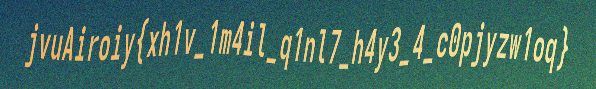

# dropped-as-a-baby


[Original report, page 18](../../cruXipher_CTF_BreakingBad_Report.pdf#page=18)

**Category** Misc / image recovery
**Points** 300

The archive contained fourteen PNG-named files with damaged signatures and IHDR fields. The red-channel LSB string
provides a key hint; assembling the visual fragments and applying Vigenere decryption recover the final flag.

Repairing the image data
The solver concatenates IDAT payloads and inflates the resulting zlib stream. The actual scanlines use 8-bit RGB and filter
type 0. Two decompressed lengths determine the geometry:

```
360400 = 400 * (1 + 300 * 3)  -> 300 x 400 pixels
360300 = 300 * (1 + 400 * 3)  -> 400 x 300 pixels
```

It asserts these lengths and filter bytes, writes a correct PNG signature and IHDR, recompresses IDAT and calculates new
chunk CRCs. Portrait tiles are rotated; the archived layout applies flips and arranges twelve tiles into the ciphertext
region.



Separating the hint from the answer
Reading red-channel LSBs from dat_0a62c9 in row-major order and packing each group of eight bits MSB-first revealed
cruXipher{k3y_1s_HEADACHE}. The combined notes report that as the flag. The later solver extracts HEADACHE from it and
applies the key to the assembled text:

```
jvuAiroiy{xh1v_1m4il_q1nl7_h4y3_4_c0pjyzw1oq}
```

The implementation preserves case, leaves digits and punctuation unchanged, and advances the key only on alphabetic
characters. That exact transcription decrypts to the saved final flag.txt:

```
cruXipher{th1s_1m4ge_m1gh7_h4v3_4_c0ncuss1on}
```

The final decryption was checked locally against the saved flag. PNG repair and LSB extraction cannot be repeated
without the original ZIP. To rerun the supplied pipeline when it is restored:

```
python dropped-as-a-baby/solve.py dropped-as-a-baby.zip
```

The solver contains a manually recovered tile layout and ciphertext transcription; it does not infer those automatically.
The documentation lesson is to follow a key-shaped intermediate result through the remaining layers before treating it
as the final answer.

Full repair and decryption procedure

1. Traverse the damaged PNGs without trusting IHDR
The solver begins chunk parsing at byte offset 8 and reads each chunk's big-endian length and four-byte type. It collects
only IDAT data for decompression. Damaged signatures, incorrect header fields, ancillary decoys and trailing data
therefore do not have to be accepted by a normal PNG viewer first.

2. Reconstruct valid scanlines and chunk checksums
Each row has one filter byte followed by three bytes per pixel. The solver selects one of the two supported dimensions
from decompressed length and asserts that every filter byte is zero. It builds a fresh IHDR using bit depth 8 and color
type 2, then calculates each new chunk CRC over its type plus payload. This repairs the container while retaining the
decompressed RGB values that carry the hidden data.

3. Read the red-channel hint
The retained extraction is:

```
a = np.array(images['dat_0a62c9'])
hidden = np.packbits((a[:, :, 0].reshape(-1) & 1),
                     bitorder='big').tobytes()
```

Flattening in row-major order fixes pixel order. Taking & 1 keeps each red value's low bit; MSB-first packing turns every
eight pixels into a byte. The extracted k3y_1s_HEADACHE phrase tells us that this stage provides a decryption key.

4. Assemble the visible text
The solver rotates portrait pieces to landscape and applies the stored flips before placing twelve tiles in a three-by-four
arrangement. The arrangement was recovered manually and is hard-coded. The saved ciphertext image supports the
transcription, including the lowercase l after q1n. Substituting digit 1 there would change which characters consume the
Vigenere key.

5. Decrypt while keeping key position aligned
For a letter, subtract the corresponding HEADACHE shift modulo 26. Preserve its original case and advance the key index
by one. Copy digits, braces and underscores unchanged without advancing the index. The first nine letters decrypt to
cruXipher, providing a check before accepting the rest of the text. The final result matches the retained flag.txt
exactly.

**Source files** dropped-as-a-baby/writeup.md, dropped-as-a-baby/solve.py, dropped-as-a-baby/flag.txt, dropped-as-a-baby/recovered-ciphertext.png, combined-writings.md.
