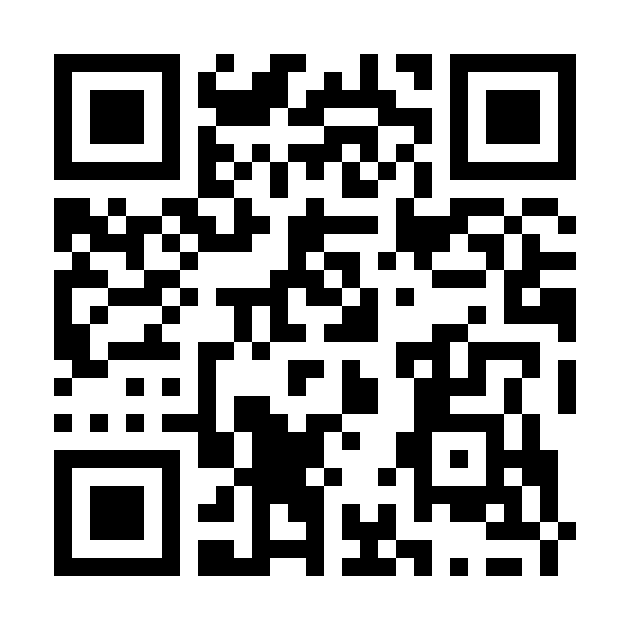

# zebra


[Original report, page 20](../../cruXipher_CTF_BreakingBad_Report.pdf#page=20)

**Category** Misc / EXIF and QR reconstruction
**Points** 285

The input, buncharandoms.zip, contained 841 uniformly black or white JPEGs, each 10 x 10 pixels. Since 841 = 29 * 29,
the images could represent QR modules. Random filenames concealed their order, but EXIF UserComment retained a
one-based position.

The solver accesses IFD 34665 and tag 37510, skips the eight-byte ASCII marker, and concatenates digits from the
comment. Examples include 34rot9ten -> 349 and 4enter66 -> 466. It rejects duplicate positions and checks that the
complete index set is a square numbered consecutively from 1.

```
x = (index - 1) % side
y = (index - 1) // side
```

Each image's pixel (0, 0) supplies its module color. A four-module white border and nearest-neighbor enlargement
make the reconstructed code readable.



The recorded QR payload is:

```
Y3J1WGlwaGVyezFfbDB2M18zeDFmX20zdDRkYXQ0fQ==
```

Base64 decoding gives:

```
cruXipher{1_l0v3_3x1f_m3t4dat4}
```

The Base64 step was independently checked. The original ZIP is absent, preventing a new audit of all EXIF indices.
Reproduction requires Pillow and OpenCV:

```
python zebra/solve.py buncharandoms.zip
```

The original category line says “Misc / compression / custom-format,” but the documented technique is EXIF ordering
followed by QR and Base64 decoding. The index uses that more precise technical description while preserving the broad
Misc classification.

Reconstructing the QR modules

1. Inspect the image set as a whole
The 841 tiny uniform JPEGs are better treated as modules of a larger image than as separate photographs. A square root
gives a 29 x 29 layout. The filenames do not supply useful ordering, so metadata becomes the next source of structure.

2. Recover an index from each EXIF comment
The solver opens each ZIP member directly, retrieves UserComment from the EXIF IFD and removes its eight-byte encoding
marker:

```
comment = im.getexif().get_ifd(34665)[37510]
text = comment[8:].decode('ascii')
index = int(''.join(re.findall(r'\d', text)))
```

Only decimal digits contribute to the index; the surrounding word is noise. The checks for duplicate indices, consecutive
numbering and a square count prevent a partially reconstructed grid from being mistaken for a valid result.

3. Place each module in row order
Convert the one-based index to zero-based coordinates using (index - 1) % side and (index - 1) // side. The
uniform color at pixel (0,0) supplies the module value. This avoids deriving module placement from ZIP order, which has
no supported significance.

4. Add a quiet zone and decode both layers
The code is pasted into an image eight modules wider and taller, leaving four white modules on each edge.
Nearest-neighbor scaling preserves hard module boundaries. OpenCV first decodes the QR payload; strict Base64
decoding then converts that payload to UTF-8. The saved QR image and recorded Base64 string preserve the latter
stages even though the original JPEG archive is missing.

**Source files** zebra/writeup.md, zebra/solve.py, zebra/reconstructed-qr.png.
